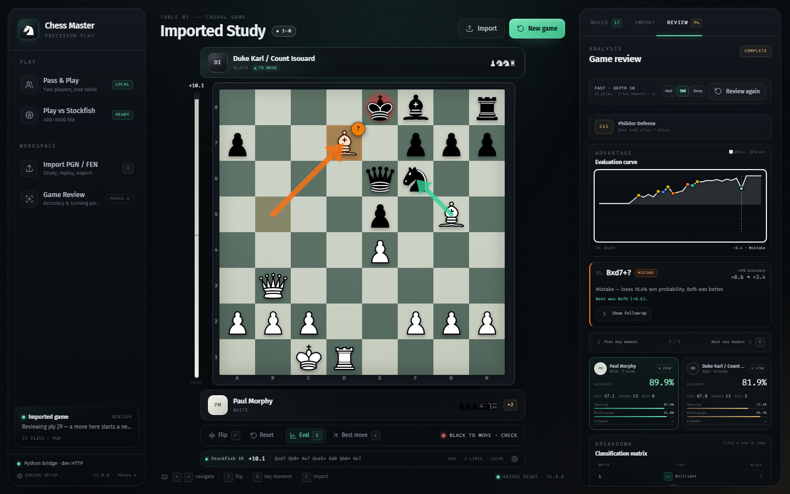

# Chess Master

A local-first chess desktop studio built with Python, PyWebView, Chessground,
Stockfish and chess.js. **v1.0.0 completes the four-phase build**: a full
Pass & Play and Stockfish table, PGN/FEN study tools, and a Chess.com-style
**Game Review** with move classification, dual arrows, an interactive advantage
curve, a coach with a playable engine line, player summaries and a
ten-tier accuracy matrix.



## What ships in v1.0.0

### Play

- **Pass & Play** on one local table.
- **Play vs Stockfish** from 400 to 3000 Elo, as White, Black or a random side.
  Presets: Beginner 600, Casual 1000, Club 1400, Advanced 1800, Master 2200,
  Grandmaster 2600 and Maximum 3000.
- **One engine, one owner thread.** A dedicated worker owns a single Stockfish
  process, coalesces jobs by kind, prioritizes bot moves and pre-empts stale
  searches. Every job carries `(game_id, revision, ply, fen)`; late results are
  discarded unless the token still matches the live revision.
- **Live analysis.** MultiPV 3 at depth 16 with a time budget, normalized to
  White POV, with a smooth win-probability rail and optional best-move arrow.
- **Import and study.** PGN headers and comments round-trip, PGN variations are
  reported as skipped metadata, FEN imports become playable custom roots, and
  playing from history creates a new branch.
- **Engine discovery.** Explicit config/CLI, `STOCKFISH_PATH`, project `bin/`
  and `assets/engine/`, then `PATH`, with a path dialog and a graceful offline
  state that never blocks Pass & Play.

### Game Review

- **Classify every move** into ten tiers: Brilliant, Great, Best, Excellent,
  Good, Book, Inaccuracy, Mistake, Miss and Blunder. Results use win-probability
  loss, forced-move handling, book detection and a confirmation pass.
- **On-board badges and tints.** The destination square gets a subtle tint and a
  circular badge at its top-right, correct in both board orientations and after
  pressing `F`.
- **Dual arrows.** The played move is drawn in its classification colour; when
  the engine preferred another move, the best alternative is drawn in emerald.
- **Interactive advantage chart.** White and Black areas meet at the 50 %
  midline, critical moments are dotted, the playhead tracks the current ply,
  hovering shows `Move · SAN · Eval · Classification`, and clicking a point jumps
  to that position. Arrow keys work when the chart has focus.
- **Coach card.** SAN header, classification pill, forced marker, accuracy,
  evaluation transition, plain-language explanation and the best alternative.
- **PV follow-up sandbox.** `Show Follow-Up` plays the engine continuation on the
  board with `← Step`, `Step →`, `Play Line` and `Back to Game`, a progress
  banner, and `Escape` to exit.
- **Dual player summary.** Names and avatars, large accuracies, an estimated Elo
  in the 400–3000 range, ACPL and per-phase accuracy.
- **Classification matrix.** Every tier shows White and Black counts; clicking a
  row filters the move list and jumps to the next matching move, while clicking a
  count filters that colour.
- **Key moments.** `Prev key moment` / `Next key moment` (or `K`, `Shift+K`,
  `Space`) walk the turning points; the counter shows your place in the list.
- **Review CTAs.** A finished game or a successful PGN import offers
  `Analyze in Game Review` in the Moves panel, switches to Review and starts or
  reopens the report.

## Quick start

### Requirements

- Windows 10/11 with the Microsoft Edge WebView2 runtime.
- Python 3.11 or newer.
- Node.js 20+ only when rebuilding CSS or vendor assets.
- A Stockfish binary. Place one at `bin/stockfish/` (the v1.0.0 build used
  Stockfish 19 universal on Windows), set `STOCKFISH_PATH`, or choose it in
  **Engine setup**. The local `bin/` folder is ignored by git.

### Install and run the desktop app

```powershell
python -m venv .venv
.\.venv\Scripts\Activate.ps1
python -m pip install -e ".[dev]"
python -m chess_master
```

If the package has not been installed editable, inject `src` on the path:

```powershell
$env:PYTHONPATH = "src"
.\.venv\Scripts\python.exe -m chess_master
```

`chess-master` is also installed as a console entry point by the editable
install.

### Development browser

The same UI can run with a loopback JSON API:

```powershell
$env:PYTHONPATH = "src"
.\.venv\Scripts\python.exe -m chess_master --serve --port 8765
```

Open <http://127.0.0.1:8765/>. The HTTP API is deliberately disabled unless
`--serve` or `--http-api` is used; the desktop window talks to Python through the
PyWebView bridge instead.

### Build and test

```powershell
npm install
npm run build          # sync vendor assets + compile Tailwind CSS
.\.venv\Scripts\python.exe -m pytest -q
$env:PYTHONPATH = "src"
.\.venv\Scripts\python.exe -m chess_master --smoke-test
```

`npm run build` is only needed after changing Tailwind source, vendored
libraries or design assets. The compiled CSS and vendor files are already in the
repository tree.

## Controls

| Input | Action |
| --- | --- |
| Drag or click a piece, then a destination | Play a legal move |
| Right-click or Shift-drag on the board | Draw an arrow |
| Left-click an arrow | Erase it |
| `ArrowLeft` / `ArrowRight` | Previous / next ply |
| `Home` / `End` | Start / live position |
| `F` | Flip the board |
| `E` | Toggle the eval rail |
| `A` | Toggle the best-move arrow |
| `I` | Open the Import / Export tab |
| `K` / `Space` | Next key moment in Review |
| `Shift+K` | Previous key moment |
| `Escape` | Leave the PV follow-up sandbox |
| Chart `←` / `→` / `Home` / `End` | Step through the reviewed line when the chart is focused |

The board is locked while a request is in flight, after checkmate or a draw,
while the promotion picker is open, and whenever it is Stockfish's turn. Chess
Master auto-orients the board to your chosen colour in an engine game; manual
flip is always available. Chessground only exposes destinations that chess.js
reports as legal for the viewed FEN; the backend revalidates every submitted
move.

## Project layout

```text
Chess Master/
|-- src/chess_master/
|   |-- app.py                 PyWebView window, dev server, smoke test, --engine
|   |-- paths.py               Project, bin, assets and web roots
|   |-- analysis/
|   |   |-- review.py          Two-pass Game Review pipeline + report contract
|   |   `-- winprob.py         Lichess logistic model, accuracy, ACPL, Elo
|   |-- bridge/
|   |   |-- api.py             JS API envelope, session lock, engine polling
|   |   `-- web_server.py      Loopback static server + optional dev JSON API
|   |-- engine/
|   |   |-- stockfish.py       Discovery, Elo profiles, cache, worker, selection
|   |   |-- coordinator.py     Session binding, scheduling, stale-token policy
|   |   |-- game.py            Authoritative session, navigation, branching
|   |   |-- pgn_io.py          PGN parse/build, comments, variation warnings
|   |   |-- fen.py             Six-field FEN validation and diagnostics
|   |   |-- material.py        Material balance and captured-piece strips
|   |   |-- replay.py          Root-FEN replay and capture detection
|   |   |-- status.py          Check, mate, stalemate and draw status
|   |   `-- errors.py          Stable domain error codes
|   |-- models/
|   |   |-- game.py            MoveRecord and PlayerInfo
|   |   `-- samples.py         Curated sample games, including the Opera Game
|   `-- web/
|       |-- index.html         Desktop interface shell + SVG icon sprite
|       |-- src/styles.css     Tailwind v4 source and visual token system
|       `-- assets/
|           |-- css/app.css    Compiled stylesheet
|           |-- js/            api, state, board, players, moves, reviewPanel, app
|           |-- fonts/         Fira Sans and Fira Code (OFL)
|           |-- pieces/        Bundled SVG piece set
|           `-- vendor/        Chessground 9.2.1 and chess.js 1.4.0
|-- bin/stockfish/             Local Stockfish binary (not a build artifact)
|-- tests/                     180 pytest checks across 14 modules
|-- scripts/sync_vendor.mjs    Reproducible vendor asset sync
|-- docs/                      Phase 1–4 UI captures and engineering reports
|-- package.json               Tailwind CLI + vendor build tooling
|-- pyproject.toml             Python package and pytest configuration
|-- THIRD_PARTY_NOTICES.md
`-- README.md
```

## Bridge API

The PyWebView object is `window.pywebview.api`. Every call returns the same
JSON-serializable envelope:

```json
{ "ok": true, "data": {}, "error": null }
```

```json
{
  "ok": false,
  "data": null,
  "error": { "code": "illegal_move", "message": "That move is not legal in this position.", "details": {} }
}
```

| Method | Arguments | Returns |
| --- | --- | --- |
| `new_game` | `mode="pass_play"`, `options={"white_name","black_name"}`; for Stockfish `options={"player_color","bot_elo","human_name"}` | Game state |
| `reset_game` | none | Game state at the imported root |
| `load_pgn` | `pgn_str` | Game state |
| `load_fen` | `fen_str`, optional `options` | Game state |
| `make_move` | UCI (`e2e4`, `e7e8q`) or SAN (`Nf3`) | Game state |
| `navigate_ply` | `ply_index` from `0` to `total_plies` | Game state |
| `get_game_state` | none | Game state |
| `engine_poll` | none | `{state, moved, thinking, evaluation, engine}` |
| `set_analysis_options` | `{"enabled","arrows","depth","multipv"}` | Options plus current evaluation and engine |
| `configure_engine_path` | `path` or `null`/`""` to auto-detect | Engine and evaluation payloads |
| `get_engine_status` | none | Engine, evaluation, cache, analysis options, model |
| `start_game_review` | preset (`fast`/`standard`/`deep`), options `{"force","use_book"}` | Review status envelope |
| `cancel_game_review` | none | Review status envelope |
| `get_game_review` | `full=True` to include the report | Review payload |
| `export_pgn` | none | `{pgn, fen, headers, ply, total_plies}` |
| `get_api_info` | none | Bridge metadata, capabilities, Elo presets, model identifiers, review capabilities |
| `get_samples` | none | Curated PGN/FEN samples |

`engine_poll` is the single non-blocking polling primitive used by both
transports. It never waits for a search; it promotes a completed bot move when
its token still matches, queues missing work, and returns the composed state.
`new_game(mode="stockfish", ...)` requires `bot_elo` in `[400, 3000]` and accepts
`player_color` of `"white"`, `"black"` or `"random"`.

Stable error codes: `invalid_fen`, `invalid_pgn`, `illegal_move`,
`promotion_required`, `invalid_ply`, `game_over`, `invalid_mode`,
`invalid_input` and the defensive `internal_error`. A promotion error includes
`details.options = ["q","r","b","n"]`.

### Game state

The full state contract is exercised by the test suite. Important fields:

| Field | Meaning |
| --- | --- |
| `fen`, `turn`, `ply`, `total_plies` | Position and view cursor |
| `moves[]` | Main-line records with SAN, UCI, FEN after, comment, promotion, capture |
| `players`, `material`, `status` | Banner, captured/material balance and terminal state |
| `last_move`, `is_viewing_live`, `branch_available` | Timeline state |
| `headers`, `event`, `source`, `mode`, `mode_label` | Provenance and PGN metadata |
| `import_meta` | Variation count, comment count and warnings |
| `engine` | Availability, status, path, bot colour/Elo, thinking, jobs, analysis options |
| `evaluation` | White-POV score, mate, win probability, MultiPV lines, PV SAN, best move, token |
| `review` | Review availability, status, progress, summary, opening and error |
| `revision`, `game_id`, `schema_version` | Diagnostics and cache invalidation |

### Game Review report

`start_game_review` runs a two-pass pipeline: a base search on every position,
then confirmation searches on classification boundaries. The report is additive
to the game state and uses `REVIEW_SCHEMA_VERSION = 2`:

| Field | Meaning |
| --- | --- |
| `moves[]` | Per-ply SAN/UCI, colour, accuracy, win loss, classification, forced/book flags, explanation, `best_move`, `pv_followup` |
| `best_move` | `{uci, san, from, to, score_cp, mate, is_played}` |
| `pv_followup` | `{start_fen, uci[], san[], fens[], moves[]}`, capped at 8 plies for the sandbox |
| `eval_chart` | `points[]` with ply, White win probability, eval, mate and classification |
| `key_moments` | Ordered turning points used by `K` / `Space` |
| `summary` / `players` | Accuracy, ACPL, estimated Elo, phase accuracy, counts by tier |
| `matrix` | Ten-tier White/Black counts |
| `timing`, `opening`, `totals` | Searches, cache hits, elapsed time, ECO/name, graded/confirmed counts |

Presets are **Fast** (depth 10 base, 12 confirm), **Standard** (14/16) and
**Deep** (16/18). Book moves are detected from the bundled opening data and can
be skipped with `use_book=false`.

### Development HTTP transport

`POST /api/<method>` with `{ "args": [...], "kwargs": {} }` and
`GET /api/health`; static files are served from the same loopback origin. This
transport exists for browser testing and headless verification, not for the
packaged desktop window.

## Review behaviour

- **Classification.** Move quality is measured as the loss in White-POV win
  probability, with separate thresholds for ordinary and forced moves. Book
  moves are labelled before classification and do not enter accuracy/ACPL.
- **Accuracy.** The approved Chess.com-style curve
  `103.1668 * exp(-0.04354 * win_loss) - 3.1669` is used per move; player
  accuracy is the mean, and ACPL is the mean centipawn loss among graded moves.
- **Estimated Elo.** A capped 400–3000 estimate derived from accuracy and ACPL;
  it is a training estimate, not a tournament rating.
- **Phases.** Opening accuracy covers book-through-opening plies, middlegame
  covers the rest, and endgame is shown as `—` when the game has no endgame
  sample.
- **Badges.** Brilliant `!!`, Great `!`, Best `★`, Excellent `✓`, Good `○`,
  Book (book icon), Inaccuracy `?!`, Mistake `?`, Miss `✕`, Blunder `??`.
  Colours are defined once as CSS tokens and reused by the matrix, coach, chart
  and board overlay.
- **PV cap.** Engine continuations are capped at 8 plies so the sandbox stays
  readable and the board never becomes a second game.

## PGN, FEN and branching behavior

- PGN headers and main-line comments round-trip through import and export.
- Variation lines are intentionally skipped; `import_meta.warnings` reports how
  many were left out. Illegal or malformed move text rejects the whole import.
- FEN must contain six fields and pass `python-chess` legality checks (kings,
  pawns, piece limits, castling, en passant and check consistency).
- A FEN import becomes a playable custom root. `reset_game` returns to that root,
  not necessarily the standard starting position.
- Navigation only moves a read-only cursor. It never mutates the move line.
- Playing while the cursor is in history truncates the future moves, appends
  the new move and resets `Result` to `*` unless the new position is terminal.
  Headers and the source event are retained. The UI announces the new branch.
- Material and captured strips are computed from the viewed ply, so replaying
  history shows the material state at that point.
- Every export rebuilds PGN from the authoritative main line and records PGN
  comments on their nodes.

## Engine and evaluation

- **Discovery order.** Explicit `--engine`/API path, then `STOCKFISH_PATH`, then
  the project `bin/` and `assets/engine/` roots, then `shutil.which("stockfish")`.
  Candidate names prefer AVX2/BMI2/modern builds and reject `.nnue` archives.
- **One process.** `Threads=1`, `Hash=128`, one owner thread, coalesced latest
  job per kind, bot jobs ahead of analysis. `analysis.stop()` cancels a search
  cooperatively when the token changes.
- **Elo mapping.** `>= 3000` runs full strength at depth 18 with a 1.2 s budget.
  `1320–2999` uses `UCI_LimitStrength=True` and `UCI_Elo=bot_elo`, with
  `depth = 10 + round(ratio * 6)`, `movetime = 0.25 + ratio * 0.75 s`, and
  `ratio = (elo - 1320) / 1680`. Below 1320, Stockfish's calibrated range does
  not apply: Skill Level spans 0–10, `depth = 3 + round(ratio * 7)`, nodes run
  from 2,000 to 182,000, and a softmax over the top three mover-POV win
  probabilities picks the move with temperature `2 + (1 - ratio) * 10`.
- **Live analysis.** MultiPV 3, depth 16 by default (accepted range 8–30), time
  budget 0.25 s plus 0.75 s per Elo ratio; the cache key is
  `(normalized_fen, depth)` and entries are reused only when their MultiPV count
  is sufficient. The cache is cleared when the engine path changes.
- **White POV.** Every score is normalized with
  `PovScore.pov(chess.WHITE)`. Mate maps to exact 0/100 win probability;
  ordinary scores use the Lichess logistic curve with `K = 0.00368208` and a
  ±1500 cp clamp. Labels are `+1.4`, `-0.8`, `0.0`, `M3` and `-M2`.

## Tests and QA

The suite covers session state, SAN/UCI parsing, navigation bounds, branching,
promotion, checkmate/stalemate, reset behavior, PGN headers/comments/variations,
export round-tripping, FEN diagnostics, material accounting, JSON serialization,
bridge envelopes, win-probability math, FEN normalization, mate/draw terminal
evaluations, Elo profiles, weighted move selection, discovery priority, worker
lifecycle/cancellation, cache reuse, HTTP engine transport, the complete Play vs
Stockfish flow, Import-mode evaluation/arrows, human-as-Black orientation, the
review report contract, PV follow-up, chart points and key moments.

```text
180 passed in 9.21s
```

Smoke test:

```text
python -m chess_master --smoke-test
2026-10-22 10:31:15,538 INFO chess_master.bridge.web_server: Serving Chess Master UI at http://127.0.0.1:40550/
2026-10-22 10:31:15,540 INFO chess_master.app: Smoke-test window created (hidden); closing in 3 seconds.
```

Browser QA used the Opera Game on a loopback server: chart hover and click,
badge placement in both orientations, dual arrows, PV stepping and `Escape`,
matrix filtering and row jumps, key moments via buttons and `K` / `Shift+K` /
`Space`, and the game-over CTA. Captures at 1280 × 820 and 1440 × 900 live in
[`docs/`](docs/).

## v1.0.0 limits

- One Stockfish process per application instance. A second table cannot run a
  second engine concurrently.
- One main line per session; PGN variations are read as metadata, not stored as
  a tree.
- No persistence database: state and the analysis cache live in memory for the
  lifetime of the API object.
- Review continuations are capped at 8 plies, and estimated Elo is a heuristic.
- The HTTP API is for local development and is bound to `127.0.0.1`; it is not
  a remote service.

## Documentation

- [Phase 2 engineering report](docs/PHASE2_REPORT.md) — engine, Elo and
  evaluation foundations.
- [Phase 3 engineering report](docs/PHASE3_REPORT.md) — design system, review
  metrics and panel architecture.
- [Phase 4 engineering report](docs/PHASE4_REPORT.md) — review dashboard, board
  overlays, chart, PV sandbox, matrix, QA and final packaging.

## Third-party components and licensing

Chessground, chess.js, Fira Sans, Fira Code, python-chess and PyWebView are
distributed with Chess Master. See [THIRD_PARTY_NOTICES.md](THIRD_PARTY_NOTICES.md)
for versions, license identifiers and the location of the full texts.

The original Chess Master source is declared MIT in `pyproject.toml`. Chessground
and python-chess are GPL-3.0-or-later; any distributed build that bundles them
must satisfy those GPL obligations. This notice is not legal advice.
