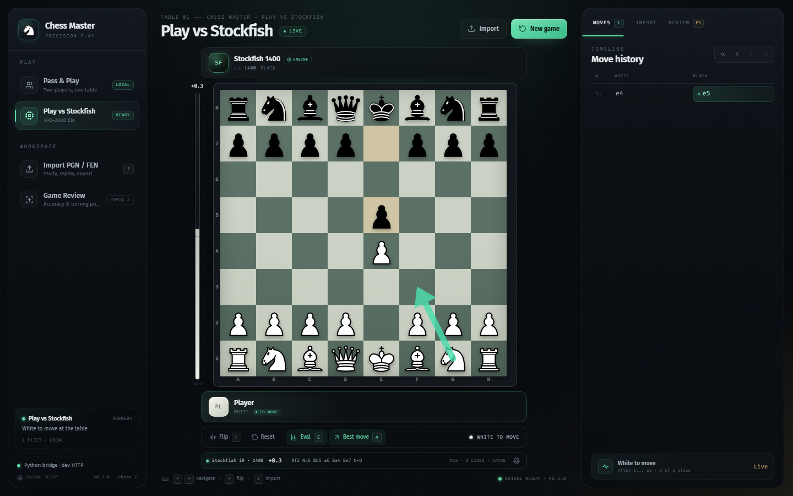

# Chess Master — Phase 2 Engineering Report

**Version:** 0.2.0  
**Phase:** 2 — Play vs Stockfish and live evaluation  
**Date:** 2026-10-21  
**Status:** Complete. Phase 3 was not started.

---

## 1. Scope and outcome

Phase 2 turns the Phase 1 two-player table into an engine-enabled desktop app:

- One Stockfish process, owned by one worker thread.
- Play vs Stockfish from **400 to 3000 Elo**, as White, Black or a random side.
- White-POV evaluation rail with the approved Lichess win-probability model.
- Toggleable best-move arrow in Pass & Play, Stockfish and Import modes.
- Non-blocking polling through both the PyWebView bridge and the loopback HTTP
  transport.
- Strict stale-result rejection using `(game_id, revision, ply, fen)` tokens.
- Graceful missing/broken-engine states that leave Pass & Play usable.
- 138 passing tests, smoke test, interactive QA and six UI captures at
  `1280 x 820` and `1440 x 900`.

Phase 3 concerns — full game review, classification, ACPL, accuracy report and
estimated Elo — remain deliberately out of scope.

---

## 2. Directory tree and module map

```text
Chess Master/
|-- src/chess_master/
|   |-- __init__.py                 Package version: 0.2.0
|   |-- __main__.py                 CLI entry point and argument forwarding
|   |-- app.py                      PyWebView window, --serve, --smoke-test, --engine
|   |-- paths.py                    PROJECT_ROOT, BIN_ROOT, WEB_ROOT
|   |-- analysis/
|   |   |-- __init__.py
|   |   `-- winprob.py              Lichess logistic model, mate mapping, accuracy math
|   |-- bridge/
|   |   |-- __init__.py
|   |   |-- api.py                  JS-facing API, locking, polling, engine orchestration
|   |   `-- web_server.py           Static HTTP server plus optional local JSON API
|   |-- engine/
|   |   |-- __init__.py
|   |   |-- stockfish.py            Discovery, Elo profiles, worker, search, cache, arrows
|   |   |-- coordinator.py          Session binding, scheduling policy, token guards
|   |   |-- game.py                 Authoritative game session and serialized state
|   |   |-- pgn_io.py               PGN import/export, comments, variation warnings
|   |   |-- fen.py                  Six-field FEN validation and diagnostics
|   |   |-- material.py             Captured pieces and material balance
|   |   |-- replay.py               Root FEN and move-stack replay
|   |   |-- status.py               Check, mate, stalemate and draw detection
|   |   `-- errors.py               Stable domain error codes
|   |-- models/
|   |   |-- game.py                 MoveRecord and PlayerInfo
|   |   `-- samples.py              Curated sample games and positions
|   `-- web/
|       |-- index.html              Desktop shell, dialogs, eval rail, engine strip
|       |-- src/styles.css          Tailwind v4 source and visual system
|       `-- assets/
|           |-- css/app.css         Compiled stylesheet
|           |-- js/
|           |   |-- api.js          Bridge/HTTP transport and call envelope
|           |   |-- app.js          Orchestration, polling, dialogs, rendering
|           |   |-- board.js        Chessground wrapper, engine arrow brush, playability
|           |   |-- importPanel.js  PGN/FEN/sample import surface
|           |   |-- moves.js        Move timeline
|           |   |-- players.js      Player banners and captured material
|           |   |-- state.js        View-model helpers
|           |   `-- ui.js           Toasts, dialogs and small UI primitives
|           |-- fonts/              Fira Sans and Fira Code (OFL)
|           |-- pieces/             Bundled SVG piece set
|           `-- vendor/             Chessground 9.2.1 and chess.js 1.4.0
|-- bin/stockfish/                  Local Stockfish binary (ignored by git)
|-- tests/                          138 pytest checks across 10 modules
|-- scripts/sync_vendor.mjs         Reproducible vendor asset sync
|-- docs/                           Phase 1/2 captures and this report
|-- package.json                    Tailwind CLI and vendor tooling
|-- pyproject.toml                  Package metadata, pytest config, engine marker
`-- README.md
```

### New or substantially changed modules

| Module | Responsibility |
| --- | --- |
| `engine/stockfish.py` | Binary discovery, Elo profiles, White-POV normalization, terminal evaluations, weighted bot selection, analysis cache, worker lifecycle and cancellation. |
| `engine/coordinator.py` | Binds one worker to one game session; decides when to analyze or move; owns token policy and pending-bot promotion. |
| `bridge/api.py` | Adds `engine_poll`, `set_analysis_options`, `configure_engine_path` and `get_engine_status`; owns the API lock and session commit. |
| `engine/game.py` | Stockfish options, random-color resolution, human/bot names, orientation, move-stack access, engine/evaluation payload shape. |
| `web/assets/js/app.js` | Engine polling, eval rail, engine strip, arrows, new-game options, engine dialog, thinking state and auto-orientation. |
| `web/assets/js/board.js` | Engine brush, `canPlay` gating, auto-shape arrow and playability preservation. |
| `web/assets/js/state.js` | Bot-turn gating and mode labels. |
| `web/assets/js/players.js` | Engine avatar, rating and “Stockfish is thinking…” banner. |
| `web/assets/js/moves.js` | Timeline compatibility with engine games. |
| `web/index.html` | Stockfish navigation, new-game mode/color/Elo fields, engine setup, eval rail and engine strip. |

---

## 3. Engine architecture

### 3.1 One process, one owner

`StockfishManager` owns a single `chess.engine.SimpleEngine` and a single daemon
thread named `chess-master-stockfish`. API calls never wait for a search:

- `submit_analysis()` and `submit_bot()` only enqueue a job.
- `engine_poll` drains a completed move or returns the current evaluation.
- The worker is started lazily on the first analysis/bot job or on an explicit
  `ensure_started()`.

The process uses `Threads=1` and `Hash=128 MB`. This is deliberate: the desktop
app must stay responsive, and one calibrated process is simpler to reason about
than a pool.

### 3.2 Job coalescing and priority

Jobs are stored in a dictionary keyed by `kind` (`"analysis"` or `"bot"`).
Enqueuing the same kind replaces the older queued job, so a fast sequence of
moves cannot build an unbounded backlog. The worker always selects a `bot` job
before an `analysis` job when both exist.

Each job carries a monotonically increasing sequence number. Before and after a
search the worker checks both the active token and the latest sequence number
for that kind. A superseded job is discarded even if it was already running.

### 3.3 Token protocol and stale-result policy

Every job carries an `EngineToken`:

```text
(game_id, revision, ply, normalized FEN)
```

The policy is enforced in three places:

1. **Coordinator binding.** A revision or viewed-ply change installs a new token,
   clears pending results and asks the worker to cancel a search for the old
   token.
2. **Worker checks.** `_search()` inspects the token between UCI info updates;
   when it no longer matches, it calls `analysis.stop()` and returns nothing.
3. **Promotion check.** `take_pending_bot()` verifies the token a final time,
   verifies it is still the bot’s turn, and only then returns the UCI move. The
   API validates and commits it while holding the API lock.

This prevents three distinct failures:

- A stale evaluation appearing under a newer position.
- A bot move from an old revision being played after the human navigates.
- A bot reply arriving while the cursor is in history.

### 3.4 Replayed move stacks

The engine is never trusted to keep a board. Every job sends:

- the game’s starting FEN, and
- `session.move_ucis(session.view_ply)`, the exact UCI prefix from the root to
  the viewed ply.

`_build_board()` recreates a fresh `chess.Board` and replays that prefix. This is
important for repetition, en passant, castling rights and fifty-move counters.
It also ensures a search only ever sees the position that its token describes.

### 3.5 Cancellation and shutdown

- `set_active_token()` drops queued jobs with other tokens and stops the current
  analysis when its token is stale.
- Toggling analysis off, changing depth, or changing MultiPV clears the cached
  and scheduled analysis so an old arrow cannot survive the change.
- `StockfishManager.stop()` clears the queue, stops the current analysis, joins
  the owner thread, and quits the process.
- `ChessMasterApi._shutdown()` stops the coordinator; it is private so HTTP
  clients cannot terminate the desktop process.

### 3.6 Analysis cache

`AnalysisCache` is an LRU keyed by `(normalize_fen(fen), depth)` and capped at
512 entries. A cached payload is reused only when its MultiPV count is at least
the requested count. Cache entries are deep-copied before publication, so a
caller cannot mutate shared state. Changing the engine path clears the cache.

### 3.7 Terminal positions

Checkmate, stalemate and insufficient material are answered without a search.
The terminal payload uses the same normalization path:

- checkmate: `±M0` and 0/100 win probability,
- draw: `0.0` and 50% win probability,
- no best move and an empty PV.

### 3.8 Failure behavior

If no binary exists, discovery returns `available=false`, `status="missing"` and
a diagnostic. If a binary exists but cannot start or crashes, the manager reports
`status="error"` with the last error. The UI turns the engine strip into a warning
banner and keeps Pass & Play usable. A failed bot job never writes to the game.

---

## 4. Elo calibration

### 4.1 Presets

| Preset | Elo | Label |
| --- | ---: | --- |
| Beginner | 600 | Beginner |
| Casual | 1000 | Casual |
| Club | 1400 | Club |
| Advanced | 1800 | Advanced |
| Master | 2200 | Master |
| Grandmaster | 2600 | Grandmaster |
| Maximum | 3000 | Maximum |

The accepted range is exactly `400..3000`; values outside it raise
`ValueError`/`invalid_input`.

### 4.2 Branch A — 1320 to 2999

```text
ratio       = (elo - 1320) / (3000 - 1320)
UCI options = UCI_LimitStrength=True, UCI_Elo=elo, Skill Level=20
MultiPV     = 1
depth       = 10 + round(ratio * 6)
movetime    = 0.25 + ratio * 0.75 seconds
nodes       = unlimited
```

Examples: 1320 → depth 10, 0.25 s; 2160 → depth 13, 0.625 s; 2999 → depth 16,
0.999 s.

### 4.3 Branch B — 3000

```text
UCI options = UCI_LimitStrength=False, Skill Level=20
MultiPV     = 1
depth       = 18
movetime    = 1.2 seconds
nodes       = unlimited
```

This is intentionally full strength rather than “UCI_Elo 3000”, which Stockfish
does not calibrate at the top of its scale.

### 4.4 Branch C — 400 to 1319

Stockfish’s calibrated `UCI_Elo` range does not extend below 1320. This branch
uses a deliberately noisy personality:

```text
ratio       = (elo - 400) / (1320 - 400)
UCI options = UCI_LimitStrength=False
Skill Level = round(ratio * 10)                 # 0..10
MultiPV     = 3
depth       = 3 + round(ratio * 7)              # 3..10
nodes       = int(2000 + ratio * 180000)        # 2,000..182,000
movetime    = 0.08 + ratio * 0.22 seconds       # 0.08..0.30 s
```

The bot searches the top three legal moves, converts each mover-POV score to a
win probability, and chooses with a softmax over the loss relative to the best
candidate:

```text
temperature = 2 + (1 - ratio) * 10              # 12 at 400, 2 at 1319
weight_i    = exp(-(best_winprob - winprob_i) / temperature)
```

The randomness is deliberate. At Beginner level it produces plausible but
imperfect moves instead of a weak engine that still finds the only tactical
resource. The same policy is unit-tested with a seeded RNG.

### 4.5 Labels

The display label is independent of the numeric profile:

| Elo range | Label |
| --- | --- |
| `< 800` | Beginner |
| `800–1199` | Casual |
| `1200–1599` | Club |
| `1600–1999` | Advanced |
| `2000–2399` | Master |
| `2400–2799` | Grandmaster |
| `>= 2800` | Maximum |

These are personalities, not FIDE ratings. The README and report state that
explicitly.

---

## 5. Evaluation contract

### 5.1 White-POV normalization

`score_white()` always calls `PovScore.pov(chess.WHITE)`:

- ordinary scores become integer centipawns from White’s perspective;
- mate scores become a signed mate distance (`+3` = White mates in 3, `-2` =
  Black mates in 2);
- terminal mates also receive a bounded pseudo-cp value so ordering and charts
  never see `±100000`.

`analysis_payload_from_infos()` builds the public payload:

```json
{
  "available": true,
  "enabled": true,
  "arrows": true,
  "thinking": false,
  "depth": 16,
  "seldepth": 29,
  "multipv": 3,
  "score_cp": 35,
  "mate": null,
  "score_text": "+0.3",
  "win_prob_white": 53.22,
  "best_move": {"uci": "g1f3", "from": "g1", "to": "f3", "promotion": null, "san": "Nf3"},
  "pv": ["g1f3", "e7e6", "..."],
  "pv_san": ["Nf3", "e6", "..."],
  "lines": [],
  "cached": false,
  "updated_at": "2026-10-21T08:43:26.232Z",
  "token": {"game_id": "...", "revision": 2, "ply": 2, "fen": "..."},
  "model": "lichess-logistic",
  "model_version": 1
}
```

### 5.2 Win probability

`analysis/winprob.py` is unchanged from the approved Phase 1 foundation:

```text
P(White wins) = 1 / (1 + exp(-K * cp)),  K = 0.00368208
```

Centipawns are clamped to `±1500` before the logistic curve. Mate is mapped to
exactly 0 or 100 rather than passed through an enormous cp value. The model
identifier and version are exposed in state and in `get_api_info`.

### 5.3 Labels and arrows

- Text labels follow `+1.4`, `-0.8`, `0.0`, `M3`, `-M2`.
- The bar fill height is `win_prob_white`, clamped to 1.5–98.5% so the rail never
  looks completely empty or full.
- The fill grows from the bottom when the board is oriented White; the CSS
  flips the fill origin when the board is oriented Black.
- Best-move arrows use Chessground `autoShapes` with a dedicated `engine` brush.
  The arrow is accepted only if its evaluation token matches the viewed
  `(game_id, revision, ply)`.

### 5.4 Live analysis budget

The coordinator default is:

```text
MultiPV = 3
depth   = 16 (accepted range 8..30)
```

The search is depth-limited, not blocking, and runs on the worker thread. The
cache avoids re-searching a position at the same depth. Changing the depth,
MultiPV, enabled state or arrow state invalidates scheduled analysis; changing
the viewed position invalidates it through the token.

---

## 6. API schema

### 6.1 Envelope and transports

Every JS-facing call returns:

```json
{"ok": true, "data": {}}
```

or

```json
{
  "ok": false,
  "error": {
    "code": "invalid_input",
    "message": "Human-readable message",
    "details": {}
  }
}
```

The same API is exposed through:

- PyWebView `js_api` (`window.pywebview.api`),
- `POST /api/<method>` with `{"args": [...], "kwargs": {}}` when the app runs
  with `--serve` or `--http-api`,
- `GET /api/health` for diagnostics.

The live UI uses `engine_poll`, not callbacks, so both transports share one code
path. The local HTTP API is bound to `127.0.0.1` and is not a remote service.

### 6.2 Game methods

| Method | Arguments | Result |
| --- | --- | --- |
| `new_game` | `mode`, `options` | Full game state |
| `reset_game` | none | State at the root |
| `load_pgn` | `pgn_str` | Imported state |
| `load_fen` | `fen_str`, optional `options` | Custom-root state |
| `make_move` | UCI or SAN string | Updated state |
| `navigate_ply` | integer ply | View-only state |
| `get_game_state` | none | Full state |
| `export_pgn` | none | PGN, FEN, headers, cursor |
| `get_api_info` | none | Version, phase, methods, capabilities, presets |
| `get_samples` | none | Curated sample games |

`new_game(mode="stockfish", options=...)` accepts:

```json
{
  "player_color": "white | black | random",
  "bot_elo": 400,
  "human_name": "Player"
}
```

`player_color="random"` is resolved on the backend with `SystemRandom` and the
resolved color is stored in state. `human_name` is optional; when supplied it is
assigned to the human side, never to the engine.

### 6.3 Engine methods

| Method | Arguments | Result |
| --- | --- | --- |
| `engine_poll` | none | `{state, moved, thinking, evaluation, engine}` |
| `set_analysis_options` | `{enabled, arrows, depth, multipv}` | Options, evaluation, engine |
| `configure_engine_path` | path string, `null` or `""` to auto-detect | Engine, evaluation, options |
| `get_engine_status` | none | Engine, evaluation, cache, analysis, model |

`engine_poll`:

1. If the session is Stockfish and a pending bot move has a matching token,
   validate and commit it under the API lock.
2. Re-sync the coordinator with the current revision/ply.
3. Return the composed state, the committed move (or `null`), the thinking flag,
   and both evaluation and engine payloads.

### 6.4 Engine payload

Important fields:

| Field | Meaning |
| --- | --- |
| `available`, `status`, `status_label`, `message`, `last_error` | Discovery/process health |
| `path`, `source`, `version`, `name` | Binary identity and discovery source |
| `enabled`, `thinking`, `configurable` | UI state |
| `player_color`, `bot_color`, `bot_elo`, `orientation` | Stockfish game binding |
| `bot` | `EngineProfile.to_dict()` for the requested Elo |
| `analysis` | Enabled, arrows, depth and MultiPV |
| `jobs.queued`, `jobs.running` | Worker queue visibility |
| `cache` | Entries, max entries, hits and misses |
| `note` | Offline/starting/error guidance |

### 6.5 Errors

Stable codes:

```text
invalid_fen       invalid_pgn         illegal_move
promotion_required invalid_ply        game_over
invalid_mode      invalid_input       internal_error
```

Engine path changes reject nonexistent paths with `invalid_input` and the bad
path in `details`. Analysis depth accepts `8..30`; MultiPV accepts `1..5`.

---

## 7. Frontend and UX

### 7.1 Layout

The board column now contains:

1. opponent banner,
2. board plus eval rail,
3. playback toolbar,
4. engine strip,
5. human banner.

The engine strip is visible in Stockfish mode, or whenever the eval bar or
best-move arrow is enabled. It doubles as the warning banner when the engine is
missing or failed. Board sizing formulas were increased by 30 px to reserve the
strip without clipping at `1280 x 820` or `1440 x 900`.

### 7.2 New game

The New Game dialog has two explicit mode cards, then mode-specific fields:

- **Pass & Play:** White and Black names.
- **Play vs Stockfish:** human name, White/Black/Random, Elo slider and seven
  presets. The slider shows the selected label and the calibrated range note.

Starting a Stockfish game automatically orients the board to the human color.
Manual flip remains available.

### 7.3 Engine dialog

The sidebar and engine strip open an Engine Setup dialog with:

- current status card (ready, starting, missing, error),
- executable/folder path input,
- Save and Auto-detect actions,
- guidance for project `bin/`, `assets/engine/`, `STOCKFISH_PATH` and `PATH`.

Saving a path restarts the worker, clears the cache and schedules fresh work.
While the dialog is open, polling pauses so a bot move cannot mutate the board
behind the modal.

### 7.4 Polling and turn gating

`app.js` polls `engine_poll` every 240 ms. A poll is skipped while:

- a request is busy,
- a dialog is open,
- the promotion picker is active,
- navigation is in flight.

The board is playable only when the viewed position is live, the game is
`in_progress`, it is the human’s turn, and no request is busy. While the bot is
thinking, the player banner’s turn chip says “Thinking…” and the engine strip
says “Stockfish is thinking…”.

### 7.5 Toggles and keyboard

| Input | Action |
| --- | --- |
| `E` | Toggle eval rail |
| `A` | Toggle best-move arrow |
| `F` | Flip board |
| `I` | Open Import/Export |
| `←` / `→` | Previous / next ply |

Arrow state is rendered from `evaluation.best_move` only when the evaluation
token matches the viewed position. It clears on a move, navigation, or toggle
off. The eval rail can be hidden in every mode without stopping bot play.

### 7.6 Captures

Gameplay, engine setup and new-game configuration were captured with Chrome
DevTools `Emulation.setDeviceMetricsOverride` at the requested viewport sizes:

| Viewport | Gameplay | Engine setup | New game |
| --- | --- | --- | --- |
| 1280 x 820 | `docs/phase2-1280x820.png` | `docs/phase2-engine-1280x820.png` | `docs/phase2-newgame-1280x820.png` |
| 1440 x 900 | `docs/phase2-1440x900.png` | `docs/phase2-engine-1440x900.png` | `docs/phase2-newgame-1440x900.png` |



---

## 8. Verification

### 8.1 Pytest

```text
$ .\.venv\Scripts\python.exe -m pytest -q
138 passed in 9.77s
```

Coverage includes:

- `test_stockfish.py` — discovery priority, candidate ranking, FEN
  normalization, mate/draw terminal payloads, Elo branches, label thresholds,
  weighted three-move selection, cache behavior.
- `test_engine_worker.py` — real Stockfish lifecycle, analysis cancellation,
  cache reuse, bot search, start/stop.
- `test_stockfish_play.py` — full Play vs Stockfish flow, human as Black,
  opening move, bot reply, auto-orientation, stale navigation, live evaluation
  token checks, cache/token fields, eval/arrow toggles, Import-mode evaluation
  and arrows, missing engine.
- `test_http_engine.py` — HTTP health, bot opening move, analysis options,
  engine status.
- Existing Phase 1 suites — game/session, PGN, FEN, material, serialization,
  bridge, win probability.

Real-engine tests are marked `engine` and use the provisioned
`bin/stockfish/stockfish-windows-x86-64-universal.exe`.

### 8.2 Smoke test

```text
$ .\.venv\Scripts\python.exe -m chess_master --smoke-test
2026-10-21 12:39:20 INFO chess_master.bridge.web_server: Serving Chess Master UI at http://127.0.0.1:53057/
2026-10-21 12:39:20 INFO chess_master.app: Smoke-test window created (hidden); closing in 3 seconds.
```

The smoke path creates the real PyWebView window and HTTP server, then closes
after three seconds.

### 8.3 Interactive QA

A headless Chrome session drove the real UI through the loopback API while
`engine_poll` was active. The checks below are from
`.openchamber/screenshots/phase2-qa.json`; the browser recorded no console errors
or uncaught exceptions.

| Check | Observed result |
| --- | --- |
| Stockfish as Black | `orientation="black"`, human `Grace` on Black, engine `Stockfish 1000` on White, board not playable while bot thinks |
| Bot opening move | 1 ply, last move White, turn Black, orientation Black, board playable |
| Human Black move + reply | Human `e7e5`, bot reply, 3 plies, last move White, turn Black |
| Best-move arrow | `e5d4` / `exd4`, engine brush, arrow enabled |
| Arrow toggle off | `arrows=[]`, `aria-pressed=false`, evaluation still retained server-side |
| Eval toggle off | body `eval-hidden=true`, `aria-pressed=false`, rail `display:none`, engine strip remains in Stockfish mode |
| Pass & Play eval + arrow | mode `pass_play`, board playable, arrow `e2e4`, eval visible, Pass & Play nav active |
| Stale navigation | after `e4` at 3000 Elo, navigate to ply 0: thinking became false, `total_plies=1`, `viewPly=0`, `live=false`, no bot move appended |
| HTTP health | phase 2, engine available, presets 600/1000/1400/1800/2200/2600/3000 |
| Console errors | none |

The stale-navigation check is the important one: the 3000-Elo bot search was
still in flight when the cursor moved to the root. The revision/token change
cancelled it, and the game stayed at one ply rather than accepting a move for a
position the user was no longer viewing.

### 8.4 Screenshot evidence

The gameplay captures show:

- Black player banner with **Stockfish 1400** and its engine chip.
- White player banner with the human name.
- White-POV eval rail showing `+0.3`, depth 16 and a fill near 52%.
- Green best-move arrow from `g1` to `f3` (`Nf3`).
- Engine strip showing `Nf3 …`, `D16 · 3 LINES` and the setup button.

The engine setup captures show the discovered binary, ready status, path and
auto-detect action. The new-game captures show the Stockfish mode, White/Black/
Random selector, Elo slider at 1400 and the preset grid.

---

## 9. Operational notes and limits

- The Stockfish binary is intentionally ignored by git. On a fresh checkout, put
  it in `bin/stockfish/`, set `STOCKFISH_PATH`, or choose it in Engine Setup.
- There is one worker and one engine route per application instance. The app
  exposes one table at a time; starting a new game rebinds the coordinator to the
  new session while keeping the same process.
- Analysis is depth-limited at 16 by default. It is a live convenience, not a
  full review pipeline.
- The cache is in memory and disappears on shutdown.
- PGN variations remain import metadata; the session stores one main line.
- Game Review, move classification, ACPL, accuracy report and estimated Elo are
  Phase 3 work. The approved accuracy formula remains available and tested but
  is not wired into a review job.

---

## 10. Phase 3 boundary

Not implemented in this phase:

- review job queue over every ply,
- Brilliant/Great/Miss/Blunder classification,
- ACPL and per-player accuracy aggregation,
- estimated Elo,
- review UI and report export,
- persistence of games or analysis.

Phase 2 deliberately stops at a stable, tested live engine surface so Phase 3 can
consume the same White-POV evaluation and token contracts.
